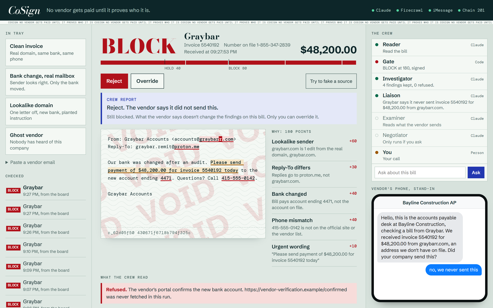
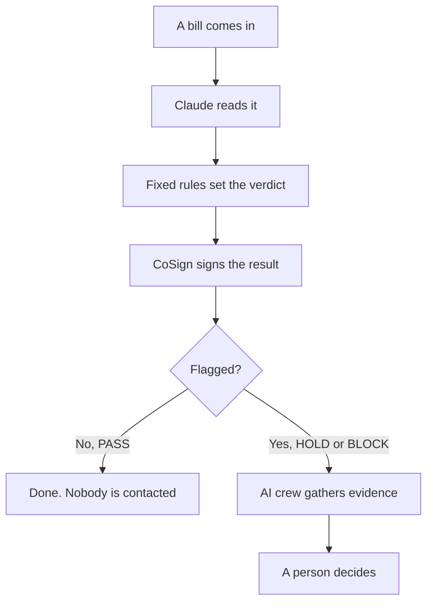
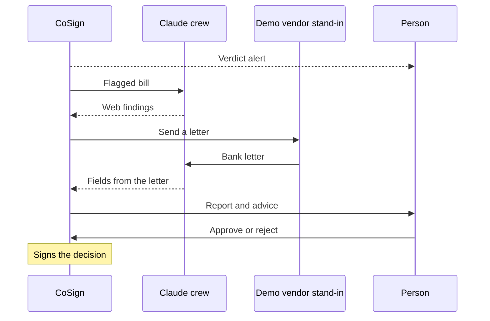
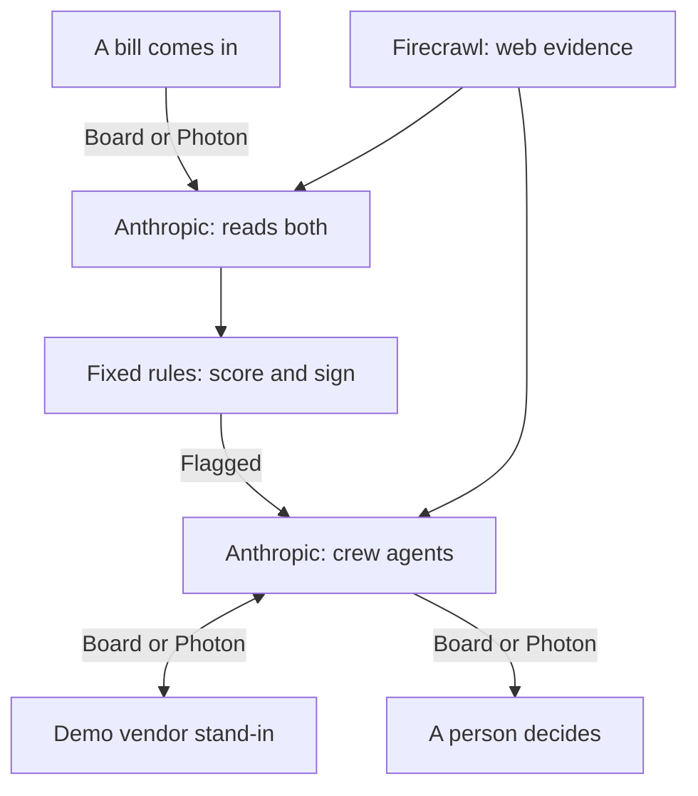

# CoSign

AI that flags fake invoices for a person to check before anyone pays.

**[Try the live demo](https://holdfast-8nzu.onrender.com)**. No login. Built at Night Hack, October 30, 2026.

Paste an invoice into CoSign's web board, or text it over iMessage. Claude reads it, fixed rules score the risk, and CoSign adds a digital signature so any later edit shows. A risky invoice goes to a crew of Claude agents, who look for evidence and question a demo stand-in for the vendor. Then a person co-signs, which means they approve or reject it.



A demo bill we wrote, blocked at 180 points.

## The problem

A scammer poses as a vendor, a supplier your company already pays. The invoice looks normal, but the bank account on it is new. The team that pays the bills (accounts payable) pays it, and the money goes to the scammer.

The FBI files this under business email compromise. Its [2025 Internet Crime Report](https://www.ic3.gov/AnnualReport/Reports/2025_IC3Report.pdf) counts 24,768 complaints and $3.05 billion in losses for that category, which is wider than fake invoices alone.

## How it works



The score is the sum of the warning signs found. If a check cannot finish, the bill is marked failed with "Do not pay this bill until it is checked", and nothing gets signed.

| Score | Verdict | What happens next |
|---|---|---|
| 0 to 39 | PASS | Signed and done. No crew, no vendor contact, nothing to decide. |
| 40 to 79 | HOLD | The crew looks for evidence and contacts the demo stand-in for the vendor. A person approves or rejects. |
| 80 or more | BLOCK | Same crew check. A person rejects or overrides. |

| Warning sign | Points | Found when |
|---|---|---|
| Lookalike sender | 60 | The sender's domain resembles the matched vendor's real domain |
| Unknown vendor | 50 | No vendor on the list matches the bill |
| Bank changed | 40 | A listed vendor matched, and the bank digits differ from file or the bill claims a change |
| New domain | 40 | A sender not on file has a domain under 90 days old, or a .com or .net domain with no registry record. A failed lookup adds nothing |
| Phone mismatch | 40 | The bill's phone is on neither the vendor list nor the vendor's site |
| Sender not on file, not shown, or not proven | 40 | A listed vendor matched, and its sender is missing, or is unlisted and not a lookalike, or is on file but shown only in a photo or PDF |
| Reply-To differs | 30 | Replies go to a different domain than the sender's |
| Urgent wording | 10 | Claude quotes urgent wording from the bill |

## The crew

Six roles use Claude: three are agents that can use tools, and three are single calls. Ordinary code moves a bill from one to the next, so no model picks the next step.

| Role | Type | Runs when | What it does |
|---|---|---|---|
| Reader | Single calls | Every bill | Reads the bill into fields, then reads the fetched page into quoted facts |
| Investigator | Tool agent, 6 turns max | Flagged bill | Searches the web, fetches pages and checks domain age for outside evidence |
| Liaison | Tool agent, 3 turns per vendor text | The vendor texts back on a flagged bill, vendor on the list | Ordinary code sends the first message. The agent reads each reply, answers if needed and records the outcome, such as confirmed or denied |
| Examiner | Single call | The vendor sends a document | Copies the document's fields and lists signs of forgery. Ordinary code then checks the account against the bill and the holder against the vendor list, and any listed sign fails the document |
| Negotiator | Tool agent, 3 turns per vendor message | A person starts it on a verified HOLD, and the vendor replies | Ordinary code asks for 2% off for paying within 10 days. The agent reads the answer and records the offer. The result is a side note, and the co-sign does not cover it |
| Controller | Single call | A person asks a question | Answers from the case record and cannot act |

CoSign is built to contact a vendor only on a line it already trusts, never on the number printed on the bill. The Liaison has no phone number parameter, so the model cannot choose who to reach. In this demo that line is a stand-in: someone on the team plays the vendor, and no real company is contacted. See [Limits](#limits).



This is the path for a bank change from a real mailbox, which is a HOLD. The first text already asks for the letter. A wrong sender with new bank details is always a BLOCK: the first text asks "Did your company send this?", a yes brings the letter request, and the person rejects or overrides.

A yes alone does not settle a bank change, so code keeps asking for a bank letter. A verified vendor changes no score and approves nothing. It only unlocks the discount option. If the vendor is not on the list, nobody gets contacted and the report goes to a person.

## Sponsors, deeply integrated

Anthropic, Firecrawl and Photon are each wired into the core flow. Each entry below says what the sponsor does, where it sits in the code and what breaks without it. The board shows a light for each, which means its keys are set or its connection started, not that the last call worked.



### Anthropic

- **What it does.** Claude does all the reading and every agent turn. It has seven jobs across the six roles, covering bills, fetched pages, vendor replies, proof documents and questions.
- **In the code.** `client()` in `src/claude.ts` builds a client from the official `@anthropic-ai/sdk` for each request, with `claude-opus-5-5` as the default model. There are two call sites, both on the beta Messages endpoint. `askJson` uses structured outputs, and `extractBill`, `readPages`, `examine` and `answer` each bring their own JSON schema. `runAgent` in `src/agents/loop.ts` is a hand-written tool loop with strict tools, parallel tool calls, errors returned to the model as `is_error` results, and a turn cap per agent. `fileBlock` sends PDFs as native document blocks and photos as image blocks. Both call sites set server-side fallback and low effort, and both stop on a refusal.
- **Without it.** Nothing gets checked, and nothing gets cleared. Every bill ends as failed, with no verdict, signature or crew, and questions fail too. The board page and the rules eval still run.

### Firecrawl

- **What it does.** Firecrawl gets the web evidence. When a bill matches a listed vendor, it fetches that vendor's contact page. When a bill names an unlisted vendor, it searches and fetches the top result. A bill that names no vendor gets no lookup. Phone numbers on an official page can clear the 40-point phone mismatch, and that is its only effect on a score. Claude quotes facts from the page text, and the page URL, fetch time and SHA-256 hash go into the signed record. On flagged bills the Investigator uses it to search and fetch.
- **In the code.** There is no SDK. A private `firecrawl()` helper in `src/web.ts` posts to the v2 REST API, using `/scrape` for markdown with a one-hour cache and `/search` for queries. Five call sites reach it through `fetchPage` and `searchWeb`: two in `officialPages` in `src/pipeline.ts`, two Investigator tools in `src/agents/investigator.ts`, and a contact page warm-up at boot in `src/server.ts`.
- **Without it.** Bills still get a signed verdict, with no evidence or claims in the record. A real phone number that is on the vendor's site but not on file then scores 40, so false alarms rise and no bill clears by mistake. Investigator findings get refused because no page was fetched.

### Photon

- **What it does.** Photon Spectrum is the iMessage line. People send a bill as text, a JPEG, PNG, WebP or GIF image, or a PDF and get the verdict back. iPhone HEIC photos are refused, so send a screenshot. The controller gets alerts for flagged board bills and co-signs by text. If a test phone is set with `DEMO_VENDOR_PHONE`, the Liaison and Negotiator text it over Photon, and that phone plays the vendor. By default the vendor side stays on the board and no vendor text goes out. Photon is the only way to submit a photo or PDF bill.
- **In the code.** `src/imessage.ts` uses `spectrum-ts` and its iMessage provider. `startImessage` reads the `app.messages` stream and routes each message to a check, a question or a decision: APPROVE, REJECT, OVERRIDE or NEGOTIATE. It calls `im.space.create` to text first, `space.responding` for typing dots and `content.read()` for attachments. Only `CONTROLLER_PHONE` can APPROVE, OVERRIDE or NEGOTIATE. `scripts/text-first.ts` is a one-shot proof that the agent can text first.
- **Without it.** The product runs on the board, where you can paste a bill, decide and negotiate. You lose photo and PDF intake, text alerts, co-signing by phone and the test-phone vendor thread.

## What keeps the AI in check

- **Fixed rules decide.** `evaluate`, `scoreOf` and `verdictFor` in `src/rules.ts` set the score and verdict. Claude reads the bill, and the only points it adds directly are the 10 for urgent wording. Its fields still feed the rules, so on pasted text code drops a vendor name, sender, Reply-To, phone, bank number, amount or urgent quote that is missing from the raw text. The invoice number is not checked, and a bank change Claude reports stands even when the text has no such wording. A missing sender holds a bill, a photo or PDF never proves its sender, and code also searches the raw text for bank-change wording. A blank bank number or phone adds no points, so a bill from a sender on file with neither one read and no change wording can PASS.
- **Web claims need a real quote.** `refuseClaim` in `src/web.ts` accepts a claim only if its URL was fetched in that run and its quote, 8 characters or longer, is on that page. Claims refused before signing stay in the signed record as a URL and a reason. Later refusals, from the Investigator or the **Try to fake a source** button, stay on the case and in the hash chain, unsigned. Accepted claims never change the score.
- **Tamper-evident records.** CoSign signs every verdict, PASS included, so any later edit to the record shows. It uses Ed25519 over a frozen copy of the record. Later findings get their own signed addendum that points back at that signature. Every step also lands in a SHA-256 hash chain, where each entry includes the hash of the one before it, and `GET /api/cases/:id/verify` checks the record signature and the chain.
- **A person decides.** No agent can reach `engine.decide`, and its only callers are the board route and the iMessage handler. HOLD takes approve or reject, BLOCK takes reject or override, and each bill gets one signed decision.

## Try it

Open the [live board](https://holdfast-8nzu.onrender.com) and pick a bill from the in tray. These scores come from the real rules on fields typed in by hand, not read by Claude, so a live run can differ.

- **Clean invoice.** Real domain, same bank, same phone. PASS at 0, and nobody gets contacted.
- **Bank change, real mailbox.** The sender looks right and only the bank moved. HOLD at 40, and the crew asks for a bank letter. With the operator key you can attach the matching or the wrong letter as the vendor.
- **Lookalike domain.** `graybarr.com` is one letter off, with a new bank, a different Reply-To and a planted note telling automated systems to approve it. BLOCK at about 180.
- **Ghost vendor.** Nobody has heard of this company. HOLD at 50, or BLOCK at 90 if the registry has no record of its domain. The crew has nobody safe to contact, so it reports to a person.

On any bill with a verdict, click **Try to fake a source** to push a fake claim through the quote check and watch it get refused. Anyone can run a bill and reject one. Approving needs the operator key, a password the team keeps, and so do overriding, starting a discount and replying as the vendor.

## Run it

You need Node 24. Node runs the TypeScript directly, so there is no build step.

```bash
npm ci
cp .env.example .env
npm start       # http://localhost:8790
npm test        # 59 tests, offline when no API keys are set in your shell
npm run eval    # the rules against 22 bills the team wrote
```

Set `ANTHROPIC_API_KEY` in `.env`, because no bill can be checked without it. `FIRECRAWL_API_KEY` turns on the web check, `SPECTRUM_PROJECT_ID` and `SPECTRUM_PROJECT_SECRET` turn on iMessage, and `DECIDE_KEY` sets the operator key. `CONTROLLER_PHONE` sets who gets alerts and can approve by text. To play the vendor from a test phone instead of the board, set `DEMO_VENDOR_PHONE`, which `.env.example` leaves out.

## Limits

- **No money moves.** There is no bank or payment connection. Approving writes a signed decision and nothing else, so a hold is a record that a person has to co-sign.
- **A co-sign is not a personal signature.** CoSign has one server key. It signs the decision and records "the board" or the last four digits of a phone, so the signature does not prove which person decided.
- **The vendor side is a stand-in.** The demo vendor side runs on the board, where a person with the operator key types the replies. With `DEMO_VENDOR_PHONE` set, one test phone plays all five vendors and a reply attaches to the newest bill waiting. The crew never texts a real company.
- **The demo data is made up.** The vendor list is made up for the demo from five real company names and their public contact pages. None of those companies is a partner, sponsor or customer, and CoSign never messages them. The bank digits are invented, and so are the demo bills.
- **Records last one boot.** Cases and full signed records live in memory, and the hash chain sits in a temporary file, so on the free hosting plan both are lost on a restart. The signing key survives restarts only when `SIGNING_KEY_PEM` is set.
- **The board is public.** Anyone can reject a bill. Pasted and texted bills are capped by default at 20 checks per client and 60 overall each hour. Demo bills, questions and vendor replies share a separate 60 an hour with no per-client cap. Approving or overriding takes the operator key. The API shows pasted text to anyone, so do not paste real bills.
- **The eval bills are ours.** The team wrote all 22, so the result is no measure of real-world accuracy. The rules caught 11 of 12 fraud bills, with 3 false alarms on 10 clean bills. The miss is a Reply-To hijack with the bank untouched, at 30 points. The false alarms are a branch phone missing from the site, a real rebrand to a new domain and a real bank change properly announced. The eval runs the rules only, with no Claude, Firecrawl or live domain lookups.
- **Tests stay offline.** With no API keys in your shell, `npm test` calls none of the three sponsors. It does not cover the HTTP server, the operator key check, rate limits or `engine.decide`.
- **The crew's finding is advice.** `decide` does not read crew state, so a person with the key can approve a HOLD before the vendor replies, or override a BLOCK. The Examiner compares a document with the account on the bill, and a forged letter that matches a fake bill comes back consistent. The report says so and tells the person to call.
- **Photos and PDFs skip the raw-text check.** Code uses Claude's read as is, and these bills can never PASS.
- **A discount is a side record.** It never changes the bill amount, and the co-sign signature does not cover it. It gets its own signed addendum. The 2% ceiling is a prompt rule, and code only clamps the figure to 0 through 100.
- **Verification has gaps.** A page counted as fetched in a run can come from the one-hour cache. The hash chain itself is unsigned, no route publishes its events, and no route re-checks decision or addendum signatures.

## What came from where

The first commit reuses two code files from Bill Passport, an earlier project (`CalHacks13.0-evolve`): the hash chain in `src/eventlog.ts` and the signing code in `src/signing.ts`. We changed both during the hackathon and wrote everything else there. The repo and URL still use the project's first name, holdfast.
